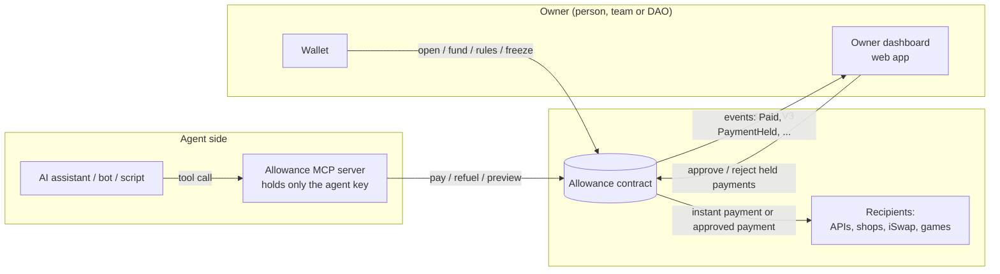
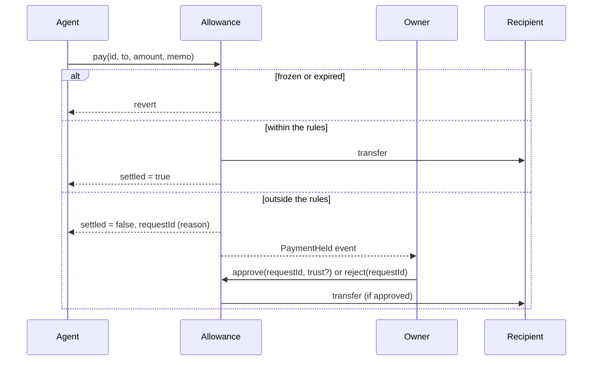

# Architecture

## Components

- **Allowance contract** (`src/Allowance.sol`): holds every account's budget and enforces the rules. The single source of truth.
- **Owner dashboard** (planned): open accounts, see spending, approve or reject held payments, freeze an agent.
- **MCP server** (planned): exposes an account to any AI assistant as tools (`status`, `preview`, `pay`, `request`). It holds only the agent key, so a prompt-injected assistant is still bound by the contract.

## Payment flow

## Account model

| Field | Meaning |
|---|---|
| `owner`, `agent` | who controls the account / which key may spend |
| `asset` | `address(0)` for POT, otherwise an ERC-20 |
| `balance` | budget held by the contract |
| `rules` | `perPayment`, `perPeriod`, `period`, `expiresAt`, `trustedOnly` |
| `spentInPeriod`, `periodStart` | instant spending in the current fixed window |
| `frozen` | kill switch |

One agent key may hold several accounts (for example a POT account for gas and payments and a stablecoin account for subscriptions). Each account has exactly one asset, which keeps the accounting simple and auditable.

## Security properties

1. Without an owner approval, an account cannot lose more than `perPeriod` in any period (payments and gas refuels combined). Fuzz-tested.
2. A frozen or expired account cannot move funds or create requests.
3. Resolved requests (approved, rejected, cancelled) are final.
4. Every state-changing function that moves funds is guarded against reentrancy, and state is updated before transfers.
5. A failed transfer reverts the whole operation, so the budget is never debited for money that did not move.
