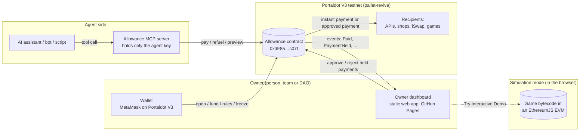
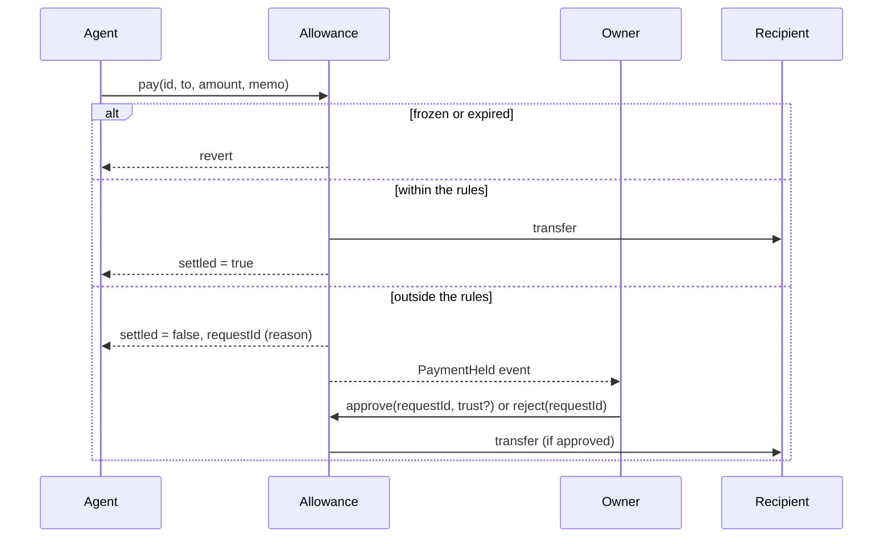

# Architecture

## Components

- **Allowance contract** (`src/Allowance.sol`): holds every account's budget and enforces the rules. The single source of truth. [Live on the Portaldot V3 testnet](../README.md#live-on-portaldot-v3-testnet).
- **Owner dashboard** (`web/index.src.html` → `docs/index.html`, [live](https://oziman13.github.io/allowance/)): one static page with no backend. It reads everything from the chain (account state and events), and every action is a transaction the owner signs in their own wallet. It opens accounts, shows spending, approves or rejects held payments, freezes agents, changes rules, and lets you try the agent side.
- **MCP server** (`mcp/`): exposes an account to any AI assistant as five tools (`allowance_status`, `allowance_preview`, `allowance_pay`, `allowance_request`, `allowance_cancel`). It holds only the agent key, so a prompt-injected assistant is still bound by the contract. It refuels the agent's gas from the same budget when needed.
- **Simulation** (`web/sim/provider.js` → `docs/sim.js`): an in-browser chain that runs the real contract bytecode in EthereumJS and exposes it as a wallet provider, so the unchanged dashboard works without a wallet or test tokens. Loaded only when someone presses *Try Interactive Demo*.

Nothing here is a trusted server. The dashboard and the MCP server are conveniences; the rules live in the contract.

## Payment flow

## Account model

| Field | Meaning |
|---|---|
| `owner`, `agent` | who controls the account / which key may spend |
| `asset` | `address(0)` for POT, otherwise an ERC-20 |
| `balance` | budget held by the contract |
| `rules` | `perPayment`, `perPeriod`, `period`, `expiresAt`, `trustedOnly` |
| `spentInPeriod`, `periodStart` | instant spending in the current fixed window |
| `frozen` | kill switch |

One agent key may hold several accounts (for example a POT account for gas and payments and a stablecoin account for subscriptions). Each account has exactly one asset, which keeps the accounting simple and auditable.

## Security properties

1. Without an owner approval, an account cannot lose more than `perPeriod` in any period (payments and gas refuels combined). Fuzz-tested.
2. A frozen or expired account cannot move funds or create requests.
3. Resolved requests (approved, rejected, cancelled) are final.
4. Every state-changing function that moves funds is guarded against reentrancy, and state is updated before transfers.
5. A failed transfer reverts the whole operation, so the budget is never debited for money that did not move.

## Cost on Portaldot V3

V3 charges a storage deposit when contract storage goes from empty to non-empty, and refunds it when the storage is cleared. Allowance is shaped around that:

- **Instant payments update existing storage only**, so they cost an agent about 0.03 POT (measured on chain).
- **Opening an account and holding a request create storage**, so they cost more (42 POT and 15 POT on the testnet today). Clearing resolved requests to get the deposit back is the first item on the roadmap.
- **The build is tuned for size** (`via_ir`, `optimizer_runs = 1`), because the code itself is stored on chain: 9.8 KB, a 779 POT deposit.

Measurements: [Getting started with Solidity on Portaldot V3](SOLIDITY-ON-PORTALDOT-V3.md).
