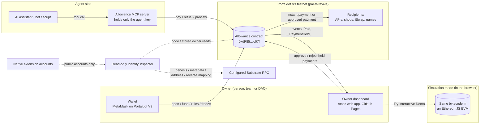
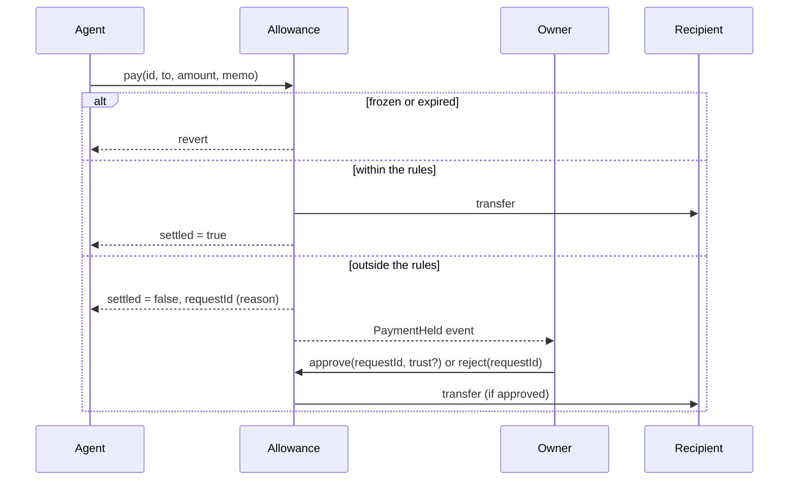

# Architecture

## Components

- **Allowance contract** (`src/Allowance.sol`): holds every account's budget and enforces the rules. The single source of truth. [Live on the Portaldot V3 testnet](../README.md#live-on-portaldot-v3-testnet).
- **Owner dashboard** (`web/index.src.html` → `docs/index.html`, [published URL](https://oziman13.github.io/allowance/)): static app with account/event reads and owner-signed writes through compatible EVM wallets. The agent tester uses its separate browser-held agent key; simulation transactions are local. Navigation, previews and native inspection are not owner-signed transactions. Public RPC reads are observations, not independent proofs.
- **MCP server** (`mcp/`): exposes five tools to compatible clients (`allowance_status`, `allowance_preview`, `allowance_pay`, `allowance_request`, `allowance_cancel`). Contract rules bound authorized escrow operations; a compromised agent's wallet funds and owner exceptions are outside that boundary. Native gas refuel withdrawals share autonomous caps, but seeds/fees/deposits differ and a zero-gas agent cannot submit its own refuel.
- **Simulation** (`web/sim/provider.js` → `docs/sim.js`): an in-browser chain that runs the real contract bytecode in EthereumJS and exposes it as a wallet provider, so the unchanged dashboard works without a wallet or test tokens. Loaded only when someone presses *Try Interactive Demo*.
- **Native identity inspector** (`substrate/browser/` → lazy `docs/native-wallet.js`): public AccountId32 discovery, chain/mapping inspection and stored-owner reads. It is read-only, never accesses/invokes a signer, never maps an account and never enters EVM owner state. Address similarity is not proof of signing control. [Live validation gates](NATIVE-WALLET-VALIDATION-PHASE3B2.md) remain unverified; native signed writes are NO-GO.
- **Spending display** (`web/spending-view.js`): separates recorded budget, budget-backed window capacity and the eligible single-payment ceiling. Financial reads and chain time must share an unchanged latest head; a failed/changed snapshot is unavailable, not zero. Freeze/expiry/zero per-payment cap stop current autonomous capacity. Unused policy headroom is explained separately; the preview checks the selected recipient and execution at a later snapshot.
- **Simulation guidance** (`web/demo-guide.js`): observes existing confirmed results and navigates to the exact held request ID, existing approval/freeze controls and dated Claude proof. It never submits a payment/approval, retries or changes authorization. The proof entry remains available when the landing section is hidden.

There is no dedicated custodial backend. The contract enforces escrow rules; owner key security, wallet-signed calldata, frontend integrity and RPC trust still matter. Internal reviews/static analysis are not independent audits.

## Payment flow

## Account model

| Field | Meaning |
|---|---|
| `owner`, `agent` | who controls the account / which key may spend |
| `asset` | `address(0)` for POT, otherwise an ERC-20 |
| `balance` | budget held by the contract |
| `rules` | `perPayment`, `perPeriod`, `period`, `expiresAt`, `trustedOnly` |
| `spentInPeriod`, `periodStart` | instant spending in the current fixed window |
| `frozen` | stops new agent pay/refuel/request operations; owner withdrawals and existing approvals remain available |

One agent key may hold several accounts (for example a POT account for gas and payments and a stablecoin account for subscriptions). Each account has one asset, but accounts using the same ERC-20 share actual token backing. The ledger assumes predictable balances and transfer debits; see the [supported-asset policy](../SECURITY.md#supported-assets).

## Security properties

1. For native POT and compatible honest tokens under unchanged policy, successful autonomous `pay` and native `refuel` debits share the budget and fixed-window `perPeriod` cap. Each call also respects `perPayment`. The native-account fuzz test checks fixed windows, not rolling intervals or arbitrary-token solvency. Owner approvals and withdrawals are outside autonomous caps.
2. Freeze/expiry block new agent payments, refuels and requests. Owner withdrawals and approval/rejection of pre-existing holds remain possible. Rotation revokes the old agent's authority but does not invalidate old requests; the current agent can cancel them even while frozen/expired.
3. Resolved requests (approved, rejected, cancelled) are final. Holds reserve no funds, and an approval uses the original recipient/amount and current budget without consuming autonomous period capacity.
4. All fund-moving entry points share a reentrancy guard. Payout effects precede external transfers; inbound token funding measures the received amount across a guarded external call.
5. Reverts, false token returns and malformed return data roll back the operation. Successful/no-data token returns do not prove honest transfers; `Paid.amount` is nominal, not guaranteed net recipient receipt.

Windows start at account creation and roll to the next `pay`/`refuel` block time after the configured duration. Two limits may be spent close together across a boundary. The owner may change policy; the contract has no invoice-splitting check.

Gas seeds are outside autonomous period accounting. Refuels share the caps but bypass recipient trust to pay the agent. Both become unrestricted wallet funds; actual gas/storage costs paid there are not individually capped by Allowance. Freeze and rotation cannot recover wallet funds.

Contract `preview` classifies a hold reason; it does not check full executability. Even a `pay.staticCall` is only a snapshot. Token economics, stale requests, lifetime-counter bounds and retained request storage are documented in [SECURITY.md](../SECURITY.md) and the [Phase 2A internal review](SECURITY-REVIEW-PHASE2A.md). This is not an independently audited deployment.

## Cost on Portaldot V3

V3 charges a storage deposit when contract storage goes from empty to non-empty, and refunds it when the storage is cleared. Allowance is shaped around that:

- **Recorded October 19/23 instant payments** updated existing storage and cost about 0.03 POT; actual costs depend on runtime/state.
- **Recorded account creation and held requests** cost about 42 POT and 11–19 POT respectively, depending on the memo. These are historical testnet measurements, not current fee quotes. The contract has no resolved-request cleanup/refund path.
- **The existing build is tuned for size** (`via_ir`, `optimizer_runs = 1`): the historical 9.8 KB deployment cost about 779 POT. No code-generation setting was changed by the jury-experience work.

Measurements: [Getting started with Solidity on Portaldot V3](SOLIDITY-ON-PORTALDOT-V3.md).

Current validation scope: **58 Foundry / 37 MCP tests** in existing CI; **24 native unit tests**, spending-display tests and browser suites run locally. Native and browser checks are not additional CI jobs. [Internal static analysis](SECURITY-STATIC-ANALYSIS-PHASE2B3.md) is complete with documented findings/limits; the deployment remains not independently audited.
