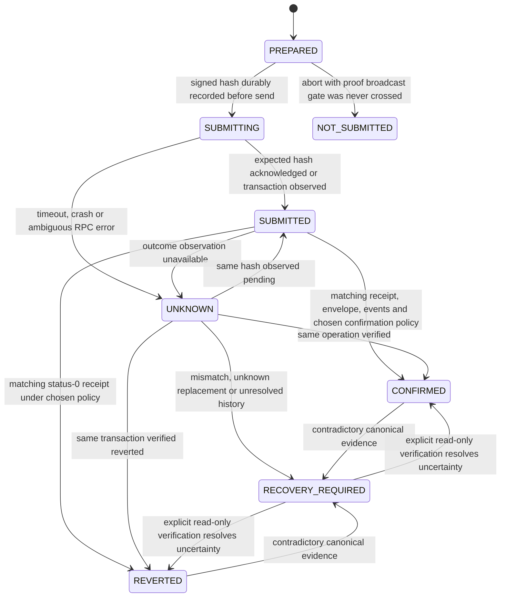

# Phase 5A-2B-1 — transaction recovery architecture and failure evidence

Date: **29 October 2026, Europe/Istanbul (UTC+03)**. Repository: `Oziman13/allowance`. Base: **`d5c3d91f411723518de5e312bcbf808c5ea88b12`**, verified by fetch and `git ls-remote origin main`. Branch: **`codex/allowance-transaction-recovery-design-phase5a2b1`**.

**Design and local fault reproduction only. No production implementation is included. Internal analysis, not an independent security audit or a production-safety certification.** This report is the sole committed change. References: [Phase 5A-1](RELIABILITY-GAP-AUDIT-PHASE5A1.md), [Phase 5A-2A](RELIABILITY-HARDENING-PHASE5A2A.md), [security policy](../SECURITY.md).

Pre-publication review on 29 October clarified durable file/directory creation, preparation/signing order, nonce-reuse restrictions, reconciliation access control and the test observer's missing validation checks. It also qualified transport retry controls against the pinned source. These are documentation corrections and implementation acceptance requirements, not implemented guarantees or new runtime test results. The original harness and recorded observations below are retained unchanged.

## Decision and executive findings

**CONDITIONAL GO for a bounded Phase 5A-2B-2 implementation:** one cooperating writer per wallet on one host, durable hash/phase records before broadcast, bounded confirmation, and keyless read-only reconciliation. **NO-GO for claiming exactly-once purchases, automatic payment recovery/resubmission, distributed wallet coordination or independently verified V3 finality.** Those guarantees are not provided by the present system or this design evidence.

The ten requested failure categories were reproduced locally. The final campaign completed **11 asserted scenario groups**, including a supplementary replacement observation; this is not 11 new CI regression tests or proof that recovery is implemented. The report embeds the exact harness and final output. Key observations:

- An RPC error **or socket closure after acceptance** left a real local payment successful but no hash in the tool result. A locally signed hash exists before contact with the RPC and can be durably recorded without storing signing secrets or raw signed bytes.
- A receipt hidden for 1,000 ms left `pay()` unresolved despite a real successful receipt. Restoring visibility produced paid with one broadcast. A receipt RPC error preserved the known hash, and no second payment was sent.
- Killing the actual MCP server after acceptance and restarting it did not recover an operation record: none exists. A separate **observer-owned shadow record**, read by a new process without a signing key, distinguished the pending transaction from its later matching Paid result. That demonstrates a read path, not production journal durability or a completed recovery implementation.
- A successful 0.1 POT refuel followed by pay preparation failure left budget/headroom debited but omitted refuel identity from the parent error. Uncertain refuel stopped the pay path; this protection must survive a future bounded-wait implementation.
- A mocked HTTP **429** after acceptance caused ethers to send the **same signed transaction twice**. There was one hash and one payment, not two payments. The current application has no resend loop, but a wire-level single-attempt promise would be false without controlling transport retries.
- Concurrent same-wallet calls chose nonce 0 twice; one paid and one failed. Duplicate successful MCP calls paid twice, and duplicate held calls created distinct IDs. These are coordination/intent limitations, not an aggregate spending-cap bypass.
- Pay rejects missing/wrong matching events. Synthetic empty-log refuel/cancel receipts are still accepted. No authentic eventless success or unauthorized contract payout was established.
- A locally mined replacement was observable by hash/sender/nonce, while the original client stayed waiting during the final **5,101 ms** observation. Earlier strict 12-second probes also did not settle. Timely ethers replacement detection was **not verified**, and this is not sufficient evidence to label an ethers vulnerability. Source inspection shows that, **when** ethers reports a replacement, the client retains only the original hash and drops its structured replacement context.

No production code, ABI, Solidity, fee/network configuration, dependency or existing MCP tool contract changes were made. No public-chain transaction or public deployment occurred. The new campaign installs a local runtime fixture with Anvil state-control RPCs and sends **zero deployment transactions**; existing test programs create their usual disposable VM/Anvil fixtures internally.

## 1. Current pipeline and guarantee boundaries

Source references below refer to the exact base, not the older line numbers in Phase 5A-1. Dependency code inspected is the repository-installed pinned ethers **6.13.4**; no external repository research was used.

| Stage | Exact current path | Enforced / observed | Missing or unproven |
|---|---|---|---|
| MCP dispatch | `mcp/index.js:15–28`, `:46–62` | Creates one client; handlers call pay/cancel and return existing text/JSON or `isError`. Five tool names/schemas remain unchanged. | No operation ID/journal, per-wallet mutation gate or stable business-intent identifier. JSON-RPC request IDs are transport correlation, not invoice identities. “Not done” can conceal partial refuel progress. |
| Input/state preflight | `mcp/lib.js:93–119`, `:192–197`, `:212–228` | Phase 5A-2A validates metadata, exact unit parsing and request scope. Pay performs `staticCall`; contract enforces current authority, freeze/expiry, limits and budget at execution. | Preflight is not a reservation. Policy, balance, agent or recipient trust can change before execution. Account balance deltas cannot identify which operation executed. |
| Gas/refuel | `mcp/lib.js:167–177` | Native-only automatic refuel shares caps, reserves an instant payment's amount and waits before pay. No token-budget native refuel. Zero gas cannot bootstrap. | Refuel and pay are separate transactions, not atomic. Fixed threshold is not a V3 fee/deposit estimate. Earlier refuel identity is attached only to a successful parent result. |
| Fees and preparation | `mcp/lib.js:69–80` | Type 2, priority fee **1 gwei**, max fee **2 × base fee + tip**, gas limit **the estimate**; base-fee fallback uses existing fee data. | RPC failure at this stage differs from failure during send. No durable prepared envelope or nonce reservation. Preserve this fee behavior; do not copy the dashboard's different legacy-deployment path. |
| Nonce/local signing | `providers/abstract-signer.js:62–78`, `:175–182`; `wallet/base-wallet.js:51–71` under `mcp/node_modules/ethers/lib.esm/` | Wallet fills nonce from pending count, populates/signs locally and passes serialized bytes to broadcast. `keccak256(raw)` is available locally. | Plain wallet (`mcp/lib.js:65`), no shared nonce coordinator; pending nonce is an observation, not a reservation. Nothing survives process exit. |
| Broadcast | ethers `providers/abstract-provider.js:740–753`; `mcp/lib.js:80`, `:199` | The provider checks returned hash against the locally parsed signed transaction after its awaited calls succeed. | Broadcast and block/network reads run together before a TransactionResponse is returned. Failure before assignment of `tx` bypasses `confirmed()`. This can be ambiguous even if a parallel metadata/block read, rather than broadcast itself, fails. |
| HTTP transport | ethers `utils/fetch.js:322–325`, `:398–425`, `:470–480`; `providers/provider-jsonrpc.js:864–900` | FetchRequest supports timeouts and retry control; JsonRpcProvider clones its connection. | Default request timeout is **300,000 ms**; default HTTP 429 handling retries. Local evidence found two raw submissions with one hash. Provider polling interval 500 ms is not a handler deadline. |
| Receipt/replacement wait | `mcp/lib.js:180–189`; ethers `providers/provider.js:1024–1026`, `:1030–1108`, `:1129–1158` | Status-1 receipt required. Known wait errors retain original hash; receipt-status-0 errors report revert. SDK can report replacement hash/receipt/reason. | Default one confirmation, timeout 0. Initial receipt/replacement work occurs **before** ethers creates its wait timer; merely setting `tx.wait(1, timeout)` does not bound every RPC or all preparation. Client discards structured replacement identity. No V3-finality verification. |
| Outcome verification | `mcp/lib.js:201–207` | Paid/PaymentHeld must match emitter contract, account, recipient, raw amount and memo. Held is not paid; actual request ID comes from the matching event. | Receipt trust remains RPC trust. Matching Paid is nominal token accounting, not net recipient delivery. Refuel/cancel use status-only confirmation (`:175–177`, `:229–231`). |
| Restart/lifecycle | `createClient`/server startup, `mcp/lib.js:58–90`, `mcp/index.js:15–24` | Reads configuration and discovers/uses an allowance; Phase 5A-2A cold request lookup works. | Startup has no old hash, original nonce, parent-child progress or result to reconcile. No replay gate for operations that existed before the journal design. |

The contract's fixed-window limits remain the primary boundary against an untrusted agent's authorized escrow debits. Owner approval of an old request, funds already in an agent wallet and unsupported token economics retain the separate boundaries in SECURITY.md. The current 42-test MCP suite includes the five Phase 5A-2A regressions; older architecture prose still quoting 37 is historical/outdated for this base and was not edited in this report-only phase.

## 2. Failure campaign: method, evidence and classifications

The exact executable harness is Appendix A. A localhost relay forwards to Anvil and changes only selected responses or scheduling. It observes transaction hashes/nonces/methods, **never persists raw signed transactions or keys**, and records actual balance/receipt effects through a separate direct local provider. Instrumentation checkpoints and the keyless reader are test-only. A shadow record written by the observer is **not a journal added to the production client**.

The runtime fixture uses the existing compiled deployed bytecode at a synthetic local address; compiler storage-layout output identifies `_lock` slot 5, initialized to 1. This bypasses a deployment transaction and is not evidence of constructor/deployment compatibility. Real account opening/pay/refuel/cancel calls execute the unmodified runtime locally. Explicit test replacements and manually mined blocks are harness actions, not automatic production behavior.

| Requested category | Deterministic injection and actual result | Classification / meaning |
|---|---|---|
| 1. Failure before broadcast | Reject `eth_estimateGas` after valid read/static preflight with refuel disabled. **0 broadcasts, nonce 0**. | Existing safe preparation boundary; current generic network explanation is less precise than the observed phase. Does not imply every “before pay” error has zero earlier refuel effects. |
| 2. Error after acceptance | Forward raw transaction, then return JSON-RPC error; separately destroy the HTTP response socket. Each produced **1 wire attempt, successful receipt, 0.1 POT delivered, no returned hash**. | Confirmed R2 recovery defect; neither outcome means not sent. |
| Supplement to 2: throttling | After acceptance, return HTTP 429 once. **2 wire attempts, 1 identical signed hash, 1 payment**, no returned hash in the final error. | Confirmed transport behavior / coverage gap. Same-byte retry is not a second purchase; do not promise one wire attempt or introduce new-nonce retry. |
| 3. Delayed/lost receipt | Hide receipts with null after real success: no result during 1,000 ms; restore and mine to wake polling: paid, one send. Receipt RPC error: known hash retained, no retry. Hide both tx/receipt to simulate pruning: keyless observer returns UNKNOWN. | Existing hash retention works after response exists; unbounded wait and unavailable-history ambiguity remain. The pruning condition is mocked, not a fresh V3 measurement. |
| 4. Termination after sign / broadcast | SIGKILL checkpointed client after signing: **0 broadcasts**. Hold accepted send response and SIGKILL the **actual stdio MCP server**: **1 accepted pending transaction**, no production journal/result. | Confirmed crash-coverage/design gap. Observer knows which side of the boundary occurred; a restarted unjournaled client does not. |
| 5. Restart unresolved | Restart actual MCP server with that pending nonce: status shows budget 5 POT, no operation API. Read observer record in a separate **keyless** process: PENDING; mine; new keyless process verifies matching envelope/Paid: CONFIRMED_EVM. **0 recovery sends**, original total sends 1. | Limited feasibility evidence for hash-based reads, not proof of a durable production state machine. Confirms why status/budget alone is not recovery. |
| 6. Refuel succeeds, pay prep fails | Actual 0.1 POT refill then injected pay-estimate failure. Budget **4.9 POT**, headroom **2.9 POT**, **0 pay broadcasts**; refuel hash absent from error. | Composite-operation reporting defect; no atomic rollback and no unauthorized transfer. |
| 7. Refuel uncertainty | Successful refuel then simulated wait TIMEOUT: original refuel hash retained. Separately acceptance error during refuel: no hash. Both have **1 refuel broadcast, 0 pay broadcasts**. | Preserve stop-before-pay protection. Losing refuel identity is the same submission-boundary gap as R2. |
| 8. Events | Six Paid missing/emitter/account/recipient/amount/memo variants reject, retaining known hash. Synthetic empty-log cancel/refuel receipts are accepted while actual cancellation/refuel did not happen. | Existing payment protection; confirmed R7 verification/coverage gap for other actions. Synthetic receipts are **not** an honest-chain exploit or proof the fixed contract emits eventless successes. Existing MCP tests also cover PaymentHeld identity variants. |
| 9. Concurrency | Barrier releases two same-wallet pending-nonce reads together: **nonce 0, 0**, one paid, one REPLACEMENT_UNDERPRICED in final run (NONCE_EXPIRED in earlier schedules). | Intentional absence of coordination, operational limitation; no aggregate-cap bypass. Results depend on local pool ordering, not claimed V3 behavior. |
| 10. Duplicate tool calls | Actual stdio MCP: two identical 0.1 calls return distinct paid hashes and deliver **0.2 POT**. Two identical held calls return distinct request IDs; cancellation of the first succeeds. Five sends including cancel. | Design limitation: different nonces/request IDs are distinct operations. No contract invoice semantics or memo-based idempotency. |
| Supplementary replacement | Explicit local same-sender/same-nonce self-cancellation mined with status 1; original pay delivered zero. Client remained waiting after additional heads and a **5,101 ms** final observation; earlier strict 12-second waits expired. | **Timely client replacement detection unverified.** Final probe asserts observable replacement and no false paid result, not successful SDK detection. SDK source and existing synthetic tests describe conditional replacement-error handling. |

The final harness exits 0 after 11 scenario assertions, but `timelyClientReplacementDetectionVerified: false` remains in raw output. Earlier development runs' replacement deadlines and a corrected scratch syntax error are not counted as passing replacement detection. No production fix or scanner suppression was used to obtain the final observation result. Exact hashes vary with local disposable fixtures; conditions and expected state/effect assertions are reproducible.

## 3. Minimal architecture: durable operation ledger plus one-wallet gate

Recommend a small coordinator inside the future client, a private local journal, and a separate **keyless recovery reader/CLI**. No Solidity/ABI changes, new owner privileges or automatic transaction retries. The five existing MCP tool names, input schemas and successful JSON shapes can remain unchanged. This section is a proposal, not implemented code.

### State is knowledge, not just a promise outcome

Use a parent operation for the authorized pay or cancel, and a child record for each actual transaction (optional refuel, then pay; or cancel). Each child follows:



| State | Required meaning / mutation policy |
|---|---|
| PREPARED | Validated intent and unsigned fields/nonce are durably recorded; no broadcast permission yet. It is **not** a gas/payment reservation. Signing may occur in RAM. |
| SUBMITTING | Expected signed hash and intent binding were fsynced **before** invoking broadcast. It means “may have been sent,” even if the process died one instruction before the network call. |
| SUBMITTED | The expected hash was acknowledged or observed. Pending is an observation attached to this state, not completion. |
| CONFIRMED | Receipt/status, expected transaction envelope and operation-specific events satisfy the recorded **client confirmation policy**. Financial outcome is explicitly PAID, HELD, REFUELED or CANCELLED. It is not an assertion of independent V3 finality. |
| REVERTED | The matching transaction has an observed canonical status-0 receipt under that policy. Escrow effects of that transaction roll back; fees and earlier child effects do not. No automatic retry follows. |
| UNKNOWN | Submission/execution might have occurred; missing receipt, transport error or process death cannot settle that question. Retain hash/nonce and gate wallet writes. |
| RECOVERY_REQUIRED | Human/read-only reconciliation is required: corruption, conflicting identity, event mismatch, unresolved replacement/history, or partial parent progress. **Never** a permission to resend. |
| NOT_SUBMITTED | Optional exceptional terminal state for provable pre-broadcast abort under a valid journal/protocol. Absence of receipt or hash alone is insufficient. A corrupt/incomplete journal cannot establish this state. |

CONFIRMED/REVERTED are terminal for the selected observation/policy, not mathematically irreversible across reorgs. Append contradictory evidence and require recovery; never silently overwrite prior history. Mere later pruning must not turn a previously observed payment into failed/not-paid or automatically reopen an intent. Return the prior recorded decision and the freshness/availability of current observations separately.

### Ordering and crash windows

1. Validate account/asset/units, recipient/amount/memo, request scope and static preflight using the existing boundaries. Acquire the **wallet-level** mutation gate before choosing/reserving its nonce or starting any mutating child, using one consistent journal path for all cooperating writers. A pre-admission validation failure sends nothing and need not be described as an uncertain financial operation.
2. Populate exactly one complete unsigned transaction with the existing fees, expected chain ID, sender and explicit reserved nonce; durably persist its parent and PREPARED child/envelope commitments **before signing**. Sign locally and derive `keccak256(raw)` from the exact signed serialized type-2 bytes, not an unsigned hash or JSON encoding. Decode those bytes and verify recovered sender, chain ID, nonce, destination, value, calldata and fee/gas fields against the prepared record. Append SUBMITTING with that hash and immutable binding; complete the persistence protocol below **before** any send invocation. Do not derive recovery identity only from the RPC's returned hash. No raw signed bytes or key enter the journal.
3. Make one broadcast invocation and prohibit transport-level replay/redirect attempts for this mutating request. On acknowledgement validate the exact returned hash, then persist SUBMITTED. A mismatched returned hash is RECOVERY_REQUIRED, not a reason to send again. Any error after crossing the broadcast gate is UNKNOWN unless positive matching evidence resolves it.
4. Poll reads under explicit budgets. Persist the verified receipt/event observation and result **before** returning a successful MCP response. If durable recording fails after chain success, return uncertainty/recording failure with the known hash and retain the wallet gate; do not claim nothing moved.
5. On startup, acquire/recover coordinator ownership conservatively, validate journal integrity and enumerate unresolved children **before accepting mutations**. Reconcile reads; never sign, rebroadcast, allocate a replacement nonce or resume an unsent pay as startup/background “repair.” The existing read-only tools may remain available independently.

Crash before the durable SUBMITTING boundary can be distinguished from uncertain broadcast **only** when the journal is valid, the old writer is stopped, all sends obey the gate, and storage durability assumptions hold. Once SUBMITTING is durable, a crash before versus after a network write is intentionally indistinguishable; missing chain data leaves UNKNOWN. This avoids inventing an exactly-once network primitive.

If a journal write/fsync fails before send, stop without sending. After send, the last durable SUBMITTING record still protects the nonce if later result recording fails. A torn/malformed record, unsupported schema, missing journal unexpectedly, disk-full or uncertain lock ownership must fail closed; do not discard a tail and assume the last convenient PREPARED record is complete history. Disk durability, permissions and crash-injection tests are implementation gates, not proven by the observer file in Appendix A.

There is **no atomic commit spanning the filesystem and RPC**. Append is not assumed atomic across crashes. On the selected, tested local filesystem, handle short writes until the complete framed/checksummed record is written, then fsync the journal descriptor. Initial journal creation and newly created state-directory entries also require the applicable parent-directory fsyncs before first broadcast; fsync of file contents alone does not establish durable naming. If snapshot/replacement is later used, fsync the new file, atomically rename on the same filesystem and fsync its containing directory before treating it as durable. Unsupported filesystem/OS semantics or failed durability steps block mutation. The observer's simple file fsync does not test this full protocol, and no hardware/power-loss guarantee is inferred from it.

### Parent/child accounting

- Record native refuel as its own child hash/nonce/amount. Refuel CONFIRMED plus pay NOT_SUBMITTED is **partial progress**, not no-op or successful payment. Surface confirmed refuel and unsubmitted pay independently.
- If refuel is UNKNOWN or RECOVERY_REQUIRED, stop before constructing/signing/broadcasting pay. If the original handler's budget expires, a late refuel receipt must **not** wake a stale continuation that sends pay. Read-only reconciliation may resolve refuel without advancing the parent mutation.
- While the original authorized handler is still active, an observed matching refuel can allow normal pay preparation within the same recorded parent/budget. Once it returns uncertainty or terminates, later mutations need a fresh explicit authorization path; version one has no automatic “resume.”
- Pay may produce matching Paid **or** PaymentHeld despite an earlier instant preview. Classify actual execution, never force the preview result. HELD means original call creation confirmed and no recipient payment; later owner approval is a separate transaction/status observation and does not rewrite the original agent transaction as an instant payment.
- Cancel is its own child bound to the scoped request/account and expected current signing actor. Verify immutable IDs and receipt outcome; do not require the account's **present** agent to equal the historical transaction sender after a subsequent rotation.

## 4. Persistent state, ownership and privacy

Persist only the minimum needed to bind identity and explain effects. Use decimal strings for chain integers; never floats for amounts or lossy JSON uint256 IDs. A proposed child record contains:

```json
{
  "schemaVersion": 1,
  "operationId": "locally-generated-uuid",
  "childId": "pay-1",
  "sequence": "7",
  "state": "SUBMITTING",
  "network": {"chainId": "420420777", "verifiedAnchor": "recorded-identity-evidence", "providerId": "configured-host-without-credentials"},
  "sender": "0x…",
  "contract": "0x…",
  "accountId": "0",
  "kind": "pay",
  "asset": "0x0000000000000000000000000000000000000000",
  "recipient": "0x…",
  "amountRaw": "100000000000000000",
  "memoHash": "keccak256-of-exact-UTF8-bytes",
  "requestId": null,
  "nonce": "12",
  "transactionHash": "0x…",
  "calldataHash": "keccak256-of-exact-calldata",
  "valueRaw": "0",
  "type": 2,
  "gasLimit": "recorded-estimate",
  "maxFeePerGas": "recorded-value",
  "maxPriorityFeePerGas": "1000000000",
  "preparedHead": {"number": "…", "hash": "0x…"},
  "confirmationPolicy": {"kind": "evm-confirmations", "count": 1, "independentV3Finality": false},
  "replacementHashes": [],
  "lastObservation": null,
  "previousRecordDigest": "…",
  "recordDigest": "…"
}
```

This is a structural example, not an executable real operation. Also retain parent-child links, authorization/source correlation where available, sanitized error codes, observation times, normalized matching receipt/events (transaction/block hashes, block number, status, log index and exact relevant arguments or commitments), selected confirmation evidence and observed replacement lineage. Hashes remain available in exceptional outcomes. Current human units/decimals can aid display, but recovery comparisons use raw units and stored asset identity.

Do **not** persist keys, seed phrases, raw signed transactions, signatures, credential-bearing URLs, full error/request dumps, or SDK debug payloads containing raw transactions. Calldata/memo commitments suffice for exact verification against a retrieved transaction/event; original off-chain memo text need not be journaled. Source/destination/amount/hash metadata remains financially sensitive even when later public on chain. Use a private directory (0700), files (0600), owner/symlink/path checks, protected backups and explicit retention. Checksummed sequence/hash chaining detects accidental corruption/reordering; it is **not tamper-proof against the same OS user** or a substitute for trusted RPC/finality evidence.

Memo/calldata hashes are integrity/correlation commitments, not encryption or a hiding guarantee: short memos and known arguments can be guessed. Protect hashed records as sensitive metadata too.

For version one, use a single-host local filesystem journal with append-only complete versioned records, monotonically increasing sequence and fsync before send. One validated source of truth avoids a multi-file intent/index atomicity problem; any index is rebuildable. Compaction/retention must never remove unresolved state and needs separately tested crash-safe snapshot/rename/directory-fsync behavior. Do not claim power-loss safety merely because a Node write resolved.

Hold a cooperating writer lock keyed by **network identity + sender**, not allowance/contract/account: one wallet's nonce stream spans all its accounts/contracts. Exclusive creation/ownership token can serialize participating processes without dependencies, but PID/elapsed-time/lease expiry alone cannot safely justify deleting a lock. Ambiguous stale ownership blocks mutations until reviewed. A crashed writer's unresolved operations remain gated even after liveness is established. The exact OS/filesystem support and stale-lock recovery protocol must be approved/tested before rollout; do not promise portable distributed locking from a lockfile.

An unresolved SUBMITTING/SUBMITTED/UNKNOWN child continues to reserve its nonce and gate new wallet mutations even if the RPC returns null or a pending count changes. Never automatically reuse that nonce, release the gate, fee-bump or sign a replacement on that basis. An advanced mined nonce is evidence of activity, not proof the recorded payment failed. Even after a proven revert or conflicting replacement, a new payment requires fresh authorization and a new prepared operation under the selected confirmation policy. Local reconciliation updates must serialize with the coordinator: a reader must not steal an active writer's lock, race state transitions or write observations that downgrade newer evidence.

All participating processes must use the same canonical state directory. Different devices, different journal directories, legacy clients and direct wallet use are **outside** this coordination guarantee. Prefer one automated writer/device per agent key. Upgrade admission requires quiescing old writers and reviewing legacy unresolved transactions: this journal cannot retrospectively recover a hash that an older process never recorded. A new state-directory setting or documented private OS state location is runtime configuration requiring explicit implementation/migration review; this phase creates no production journal location.

## 5. Read-only reconciliation and bounded waiting

### Reconciliation algorithm

1. Load a valid operation record; verify configured network/contract/sender context and recorded schema. Check actual RPC chain identity rather than treating `staticNetwork: true` as an attestation. Anchor/code checks strengthen context only under explicit RPC trust; identical chain IDs alone do not distinguish every fork. Use only configured project endpoints.
2. Query **the stored hash** for transaction and receipt. No transaction/receipt is UNKNOWN for an unresolved operation, not failed/dropped/not-sent. A visible transaction with no mined block is pending/SUBMITTED. Included transaction without available receipt remains unresolved. A previously recorded confirmation plus unavailable current history remains a historical observation, with freshness explicitly unavailable; no repayment is authorized.
3. Require transaction hash, chain ID, sender, nonce, actual destination contract, native value, calldata commitment and expected method/arguments to match. “Recipient” inside pay differs from the transaction's outer `to`. A receipt alone or any Paid event elsewhere is insufficient.
4. Require correct receipt hash/status/block context; re-read the canonical block at that height after evidence collection. Reject removed/orphaned logs and mismatched/changing block hashes. For a matching status-0 receipt record REVERTED under the selected policy; do not invent a revert reason when tracing/historical state is unavailable.
5. For status 1, verify **operation-specific** emitter and arguments: Paid or PaymentHeld account/recipient/raw amount/exact memo commitment; held request ID/reason and actual HELD result; Refueled account/agent/amount; RequestResolved request/account/**Cancelled** status. Bind the event to this receipt's transaction, not equal purchase fields in arbitrary history. Missing/mismatched evidence means RECOVERY_REQUIRED even if receipt status is 1. Nominal token settlement still does not prove net service/token delivery.
6. Preserve any replacement candidate from an SDK exception or a verified same-sender/same-nonce transaction read. Ethers' `reason` label is a hint, not completion proof. Verify candidate hash/envelope/receipt and distinguish same-call fee replacement from self-cancellation/different call. Record **both** original and replacement hashes and all relevant observations. A successful different replacement is not a successful original payment.
7. Without a known replacement hash, a nonce advance only proves activity at that nonce, not its identity/result. Standard JSON-RPC has no universal sender-and-nonce lookup. A bounded scan of available blocks from the recorded prepared-head anchor may find candidates; cap work, retain a cursor and revalidate anchors. Missing/pruned history, unsupported full-block reads or exhausted budget leaves RECOVERY_REQUIRED. No alternate indexer/RPC or invented candidate from memo equality.
8. Return observations and policy/freshness, append local evidence under coordinator ownership if applicable, and **never** call sign/send/refuel/pay/cancel/approve as reconciliation. Rechecking a canonical hash is still RPC evidence, not independent finality proof. Inability to prove the result must remain visible indefinitely rather than expire into permission to pay again.

Historical pruning is especially relevant on V3: the repository records null tx/receipt responses and discarded historical state after a day or two, while logs remained queryable. This is historical project evidence, not a freshly measured retention SLA. Persist observations promptly. A bounded exact-contract/exact-hash log search can provide **historical effect evidence**, but must not silently upgrade a missing receipt/envelope into a freshly verified CONFIRMED result. Never search by memo/amount and adopt another identical operation's hash.

### Deadlines, cancellation and transport behavior

Proposed initial engineering budgets, to validate rather than deploy in this phase: **120 s total parent handler**, **at most 60 s confirmation per child clamped by remaining parent time**, **5 s per RPC**, maximum **12 receipt-poll attempts per child**, approximately 1 s spacing with all sleeps/reads clamped to the remaining monotonic deadline. Reconciliation has its own bounded read/work budget and resumable cursor. These are availability choices, not claims that V3 should finalize within those times; local tests should shorten them to deterministic sub-second budgets.

Use supported FetchRequest timeout/attempt controls with the pinned provider and test actual HTTP behavior. Source inspection shows `clone()` preserves throttle/retry settings, and `setThrottleParams({maxAttempts: 1})` limits the 429 retry path in ethers 6.13.4. This is a proposed control, **not a tested single-wire-attempt guarantee in this phase**. The same version's `redirect()` permits GET only, so its HTTP JSON-RPC POST is not followed through the 301/302 redirect path; a different transport/version must not inherit that assumption. Attempt limits alone are not a general redirect/security policy. Independently test the actual broadcast POST, throttling, redirects, batching and cloned connection settings before promising one wire attempt or no forwarding. Keep configured endpoints and credentials policy unchanged. Read polling may be repeated within its explicit budget; broadcast may not allocate another nonce/signature or automatically replay bytes. The 429 reproduction proves why counting only `pay()` calls is insufficient.

Do not implement this as `Promise.race(existingPay(), timeout)`: the abandoned pay continuation could later send/refuel after the caller was told unknown. Cancellation/generation tokens must be checked before every mutation boundary and after awaited preparation, and a timed-out parent must never advance to another child. Bound/cancel underlying requests where supported, unregister listeners and ignore stale completions. A timeout during send cannot roll back acceptance; persist UNKNOWN and keep the wallet gated. Ethers' wait timeout alone does not bound its earlier RPC work, and destroying a provider is not proof a transaction failed.

### RPC confirmation versus V3 finality

For compatibility, current successful MCP semantics use one EVM receipt plus matching payment evidence. A first implementation may preserve this explicitly recorded **EVM-confirmations policy** for supervised testnet operation, while returning `independentV3Finality: false` in the separate recovery API. Do not call it independently finalized. Revalidate recent unresolved/contradictory evidence, and surface reorg changes; pruning alone must not manufacture a failure or reopen a completed payment intent.

No assumption is made that an Ethereum `finalized` tag, EVM block hash/number and Substrate finalized hash correspond identically on V3. Stronger finality requires an independently verified mapping/read capability and trusted finalized-chain evidence through the configured hosts. The current environment cannot establish it. Mainnet/material-value readiness remains blocked on a stronger reviewed finality and RPC-trust policy; changing a confirmation counter is not a substitute.

## 6. Recovery API and compatibility proposal

Do not add a sixth MCP tool or change any of the five input/success contracts in Phase 5A-2B-2 without separate approval. First expose a local operator CLI or internal library reader that accepts **no private key** and never calls `createClient` to obtain a wallet:

| Proposed call | Behavior |
|---|---|
| `operations.list({network, sender, unresolvedOnly})` | Read journal summaries/IDs/hashes, parent-child phases and last observations; no wallet creation. |
| `operations.inspect({operationId})` | Read exact recorded identity, effects and freshness; do not accept caller-substituted amounts/recipients as truth. |
| `operations.reconcile({operationId, readBudget})` | Bounded configured-RPC reads and validated local observations; no sign/send or resume. It may append local evidence under the journal protocol, but is **read-only on chain**. |

**Keyless does not mean unauthenticated or unrestricted.** Initial scope is an operator-owned local CLI/library under the journal owner's OS identity, not a public HTTP/MCP service. Enforce directory/file ownership and mode, reject symlinks/path traversal, resolve validated operation IDs only inside the configured trusted state directory, and do not let record/caller data select arbitrary RPC endpoints or filesystem paths. Read-only inspection exposes sensitive metadata; any later multi-user/network interface needs separate authentication, authorization and tenant isolation. Read-only chain access grants no permission to mutate journal files: appending reconciliation evidence requires the coordinator's local ownership/serialization protocol. No private key is needed, and no wallet/signer capability should be instantiated or inherited by that reader.

A proposed result separates `recordedState`, `currentObservation`, `businessOutcome`, `children`, `transactionHashes`, `replacementHashes`, `receiptEvidence`, `confirmationPolicy`, `freshness`, `reasonCode` and `nextAction`. A pending/unknown response must include every known child hash, not a generic “Not done.” Return amounts/IDs as exact strings in this **new recovery interface**, not by changing existing tool schemas. A missing or corrupt record cannot be reconstructed from request text and declared safe.

Normal current tool successes remain unchanged (paid/held/cancelled fields and transaction references). Error envelopes can retain `isError: true` plus truthful text that names operation ID, known hashes and partial progress; schema compatibility and strict-client behavior need tests. Successful MCP response loss remains a separate delivery ambiguity: fsync the outcome before writing the response, but a successful stdio write does not prove the caller received it.

Without a stable caller intent key, a fresh identical `allowance_pay` after a prior **confirmed** outcome is indistinguishable from a legitimate repeat purchase. The ledger can prevent blind mutation while an earlier result is unresolved and can return it through recovery; it cannot promise invoice-level exactly-once delivery through the unchanged five tool contracts. Do not silently co-opt transport IDs, memo text, amount/recipient equality or an environment-wide “intent ID” for all calls. A versioned optional intent contract or separate approved caller wrapper is a future decision.

## 7. Idempotency and concurrency tradeoffs

| Mechanism | Meaningful benefit | Limits / recommendation |
|---|---|---|
| Persistent generated operation IDs | Stable local correlation across crashes; lookup/error identity; parent-child linkage. | New ID per call does not detect repeated business intent. **Implement first**, without exactly-once claims. |
| Local durable journal | Recover hash, nonce, expected effects and prior evidence; gate unresolved work. | Disk/privacy/corruption/migration concerns; cannot stop independent key holders. **Implement with failure tests**, not a JSON dump of SDK errors. |
| Per-wallet coordination | Prevent self-colliding nonces and stale refuel/pay continuations across accounts. | In-memory queue dies with process; NonceManager alone lacks durable recovery. A shared local protocol coordinates only cooperating writers. **Use one host/writer initially**. |
| In-memory deduplication | Cheap prevention of overlapping handler work in one process. | Lost on restart; equal parameters can represent legitimate distinct purchases. Cannot be the financial recovery boundary. |
| Persistent intent deduplication | A stable caller-supplied intent ID bound to immutable network/account/asset/recipient/amount/memo can return the prior result and reject mismatched reuse. | Needs a reliable caller/business protocol, shared storage and explicit interface authorization. Legacy calls remain independent. Do not pretend operation IDs generated after each call solve it. |
| Contract-level idempotency | Could enforce an intent identifier against all clients for a future deployment. | Requires Solidity/ABI/deployment changes and new semantics; **out of scope**, unavailable on the existing contract. |
| Distributed coordinator / shared database | Can coordinate multiple devices if all writes and key usage are fenced through it. | Larger trust/operational/dependency surface; not the smallest solo-founder implementation. Do not label a local file lock distributed-safe. |

Recommended first version: a durable local operation ledger, one cooperating writer per wallet, fail-closed unresolved-operation gate and keyless reconciliation. Legacy duplicate **completed** purchases remain an explicit limitation; require a separately reviewed stable-intent protocol before claiming stronger autonomous financial guarantees. Fixed-window aggregate caps and owner exceptions stay exactly as deployed. Payment splitting across calls/windows remains an agent/business-intent issue, not something this journal makes impossible.

## 8. Portaldot constraints and current verification blocker

Preserve type 2 transactions, **1 gwei tip**, **2 × base fee + tip**, and the method's exact gas estimate from `mcp/lib.js:69–80`. Record these actual populated values per child. Do not add a fee bump, gas multiplier, replacement policy, legacy fallback or funding loop under the name of recovery.

The repository's October 19/23 measurements include about **0.032 POT** instant payment cost, **11.56–19.24 POT** held-request cost depending on memo storage, about **0.019 POT** owner approval and **3.86 POT** freeze. They are historical measurements, not current fee/deposit guarantees. The existing 0.05 POT threshold/0.1 POT typical refill does not guarantee affordability of a held request. Native seeds/refuels become free wallet funds; actual fees/deposits are outside per-transaction escrow metering. Recovery must never source funds or enlarge refuel to force progress. ERC-20 allowances still need separate native gas.

Some older Solidity-on-V3 prose says “Don't set a priority fee,” but the later same-document 1010 observation and current verified implementation use the explicit 1 gwei EIP-1559 behavior. Treat the actual current path and scoped recorded evidence as the baseline; do not silently switch fees based on a general sentence. Storage refund/pruning/pool observations may change with runtime upgrades. Anvil verifies no V3 storage-deposit, pool-admission, pruning or finality guarantee.

Fresh read-only attempt at **11:30:55 Istanbul / 08:30:55 UTC**:

```sh
curl --max-time 10 -sS -H 'Content-Type: application/json' \
  --data '{"jsonrpc":"2.0","id":1,"method":"eth_chainId","params":[]}' \
  https://test-evm-rpc-v3.portaldot.dev
```

Result: **curl exit 56**, `CONNECT tunnel failed, response 403`; **HTTP/1.1 403 Forbidden**, `server: envoy`. No target response was obtained. Current identity/runtime/finality/history behavior remains unverified. No alternate RPC, unrelated website/repository, VPN or proxy bypass was used. This is an environmental access blocker, not evidence the testnet is down.

## 9. Phase 5A-2B-2 implementation sequence and acceptance gates

These are proposed future changes; none is implemented here.

1. **Agree on journal/ownership/compatibility policy.** Define supported local OS/filesystem, private state path, single-wallet ownership protocol, schema/recovery API, migration from legacy writers and the selected EVM confirmation policy. Preserve current five-tool successes and EIP-1559 behavior. Benefit: measurable scope that does not accidentally promise distributed/exactly-once/finality guarantees.
2. **Build the journal and admission gate before changing send.** Fault-inject disk-full, permission denial, unsupported schema, short/partial/torn writes, failed file/directory fsync and rename, lock conflicts, stale/reused PID and concurrent clients sharing a wallet across accounts. Include first journal/directory creation and snapshot replacement, not only appends to an existing file. Before durable SUBMITTING, every injected journal failure must produce **zero broadcast attempts**. Corrupt/missing expected state must block mutations, not reset history. Verify reader/path access controls and that no key/raw signed payload/error dump is written. Benefit: no untracked money-moving network request under the stated storage assumptions.
3. **Separate prepare/sign/record/broadcast.** Preserve exact normalized calldata and fees; persist PREPARED, compute local hash, persist/fsync SUBMITTING, broadcast once, record acknowledgement. At each boundary use SIGKILL checkpoints; restart must retain hash/nonce or provable NOT_SUBMITTED, without signing/broadcasting. Inject JSON-RPC error, socket loss, 429 and redirects after acceptance; assert **one wire attempt when configured**, no new nonce/signature, and 0.1 POT delivered at most once. Benefit: demonstrable recovery identity even when no TransactionResponse exists.
4. **Add bounded read confirmation and exact action verification.** Inject each RPC timeout, null/delayed receipt, mismatch, status 0, contradictory/removed block/log and visible/unavailable replacement. Assert exact emitter/envelope/arguments for Paid/PaymentHeld/Refueled/RequestResolved. Record original and candidate replacement identity; different-call replacement must not report paid. Every handler returns within its tested budget and leaves no stale continuation capable of sending. Preserve all existing 42 MCP tests and the R1/R4/R5 no-send guards. Benefit: accurate bounded outcomes, not generic promise rejection handling.
5. **Integrate parent refuel/pay progress and keyless reader.** Refuel known/unknown/failed, then pay preparation/send/wait failures must preserve both child states and hashes. If refuel is unresolved or the parent timed out, payment broadcasts must remain **zero even after a late successful refuel response**. A new read-only process must reconcile pending → matching receipt with **zero sign/send calls**, no key configuration, and no automatic parent resume. Benefit: no hidden partial debit or recovery-driven payment.
6. **Validate concurrency/duplicates and target-runtime boundaries.** Concurrent supported mutations must serialize without nonce collision or reject before sign; unsupported external/multi-device writers must remain explicitly unsupported/detected as conflicting observations where possible. Show duplicate confirmed legacy calls are still distinct and document the need for a future intent contract; never globally deduplicate memos. Once configured hosts are available, perform separately authorized read-only V3 identity/history/receipt/finality-mapping validation before stronger claims. Benefit: quantify actual supported coordination and deployment assumptions.

Tests should assert effects, phases, wire attempts, persisted identity, no-secret state and restart observations rather than merely increasing case counts. Persistence tests must include the crash between durable intent and network send, and between chain success, journal result and MCP response. The observer shadow record in this phase does not test those future write-order guarantees. Process-kill evidence is not power-loss/fsync-hardware proof.

## 10. Existing tests, reproducibility and final scope

Reused Forge **1.7.1** (`4072e48705af9d93e3c0f6e29e93b5e9a40caed8`), solc **0.8.28+commit.7893614a.Linux.g++**, Node **24.19.0**, ethers **6.13.4** and existing dependencies. No installation, upgrade or lockfile change. Local Solidity settings remain Cancun/via IR/optimizer one run. Current CI runs Foundry/MCP; no new CI run is claimed for this report-only local branch.

```sh
/workspace/.allowance-tools/node_modules/@foundry-rs/forge-linux-amd64/bin/forge build --use /workspace/.allowance-tools/solc-0.8.28 --sizes
/workspace/.allowance-tools/node_modules/@foundry-rs/forge-linux-amd64/bin/forge test --use /workspace/.allowance-tools/solc-0.8.28 --fuzz-seed 0x5a2b1 -vv
ANVIL=/workspace/.allowance-tools/node_modules/@foundry-rs/anvil-linux-amd64/bin/anvil npm test --prefix mcp
npm test --prefix substrate
node script/spending-view.test.cjs
/workspace/.allowance-tools/node_modules/@foundry-rs/forge-linux-amd64/bin/forge inspect src/Allowance.sol:Allowance storageLayout --use /workspace/.allowance-tools/solc-0.8.28 --json > work/phase5a2b1/layout.json
node --check work/phase5a2b1/recovery-probe.mjs
node work/phase5a2b1/recovery-probe.mjs
/workspace/.allowance-tools/node_modules/@foundry-rs/forge-linux-amd64/bin/forge fmt --check
git diff --cached --check
```

| Check | Actual result |
|---|---|
| Foundry build / storage layout | **Exit 0** |
| Complete Foundry, seed `0x5a2b1` | **58 passed, 0 failed/skipped**, four suites; included 1,000-run fuzz and 128×128 / 16,384-call invariant, zero handler reverts |
| Complete MCP | **42 passed, 0 failed/skipped/cancelled**, localhost fixtures; includes five Phase 5A-2A regressions |
| Native / display units | **24 / 10 passed**, zero failed/skipped/cancelled |
| New fault harness | Final **exit 0**, 11 asserted scenario groups; ten mandatory categories reproduced; supplementary timely replacement detection remains **unverified**, explicitly recorded false |
| Scratch syntax / final report links / whitespace / scope | Passed |
| `forge fmt --check` | **Exit 1**, pre-existing differences in unchanged `src/Allowance.sol`, `test/Allowance.t.sol`, `test/mocks/MockTokens.sol`; no formatting applied |

Only this report is committed. Scratch code/logs and observer record remain under excluded `work/phase5a2b1/`; the exact harness/final output are embedded below. No permanent tests, production source, Solidity, ABI, frontend, network/deployment configuration, dependencies, five tool contracts or historical reports changed. Existing untracked `lib/` is also excluded. No push, PR, merge or public deployment/transaction is part of this delivery.

**Remaining blockers:** current V3 RPC access; unverified timely SDK replacement detection; storage/lock/crash durability not yet implemented/tested; no independent finality mapping; no stable caller intent contract or distributed writer guarantee; and no retrospective recovery of legacy unknown hashes. The next authorized implementation should address the local journal/read-only recovery core, not automatically repay uncertain operations or broaden contract powers.

## Appendix A — exact local evidence harness

Save the following code as `work/phase5a2b1/recovery-probe.mjs` under this repository, generate `layout.json` with the command above, and use the existing pinned artifacts/tools/dependencies. Ports **8549/8550** must be free. The code asserts the local runtime layout and never deploys a contract by transaction. It creates/disposes local fixtures and kills only its own disposable child processes. The key in the source is the public standard Anvil fixture, not a real wallet secret. Never replace the RPC URLs or fixture key with public-chain configuration.

The small `observe` helper is a **test-only partial reader for the local pay fixture**. It demonstrates envelope/event reads without a key; it is not the complete proposed reconciler, journal protocol, replacement scanner, V3 identity/finality verifier or production implementation. Its observer-owned file is not proof the MCP process durably recorded its own operation. No raw transaction/private-key material is written to that record.

In particular, this helper does **not** explicitly require status exactly 1 before its positive event branch, compare returned receipt/transaction hashes with the requested hash, verify actual RPC chain identity, reject removed-log flags or enforce a configurable confirmation count. Its positive result was observed with the honest local status-1 fixture; it is not safe acceptance logic for arbitrary RPC responses. Section 5 requires those checks for the proposed implementation. Neither this reader nor its observer file may be promoted into production by copying it unchanged. No additional fault-injection coverage for these omitted checks is claimed here.

```js
// Local evidence only: no public RPC, no deployment transaction, no production-code edits.
import assert from 'node:assert/strict';
import { spawn, fork } from 'node:child_process';
import { once } from 'node:events';
import { createServer } from 'node:http';
import { readFileSync, openSync, writeFileSync, fsyncSync, closeSync } from 'node:fs';
import { fileURLToPath } from 'node:url';
import { ethers } from '../../mcp/node_modules/ethers/lib.esm/index.js';
import { Client } from '../../mcp/node_modules/@modelcontextprotocol/sdk/dist/esm/client/index.js';
import { StdioClientTransport } from '../../mcp/node_modules/@modelcontextprotocol/sdk/dist/esm/client/stdio.js';
import { createClient, ABI, explain } from '../../mcp/lib.js';
const RPC='http://127.0.0.1:8549', RELAY='http://127.0.0.1:8550';
const ADDRESS='0x000000000000000000000000000000000000A110', E=ethers.parseEther;
const iface=new ethers.Interface(ABI), sleep=ms=>new Promise(r=>setTimeout(r,ms));
const hashMemo=memo=>ethers.keccak256(ethers.toUtf8Bytes(memo));
async function until(fn,label,ms=12000) { const end=Date.now()+ms; while(Date.now()<end) { if(await fn())return; await sleep(20); } throw Error('deadline: '+label); }
async function bounded(p,label) { let timer; try { return await Promise.race([p,new Promise((_,reject)=>{timer=setTimeout(()=>reject(Error('deadline: '+label)),12000);})]); } finally {clearTimeout(timer);} }
function durable(path,record) { const fd=openSync(path,'w',0o600);try {writeFileSync(fd,JSON.stringify(record));fsyncSync(fd);} finally {closeSync(fd);} }
// Isolated read-only evidence probe, NOT an implementation used by the MCP client.
async function observe(record,p) {
  const receipt=await p.getTransactionReceipt(record.hash), tx=await p.getTransaction(record.hash);
  if(!receipt) return {state:tx?.blockNumber==null&&tx?'PENDING':'UNKNOWN',receipt:null,transactionVisible:!!tx};
  if(!tx||tx.from.toLowerCase()!==record.sender.toLowerCase()||tx.to?.toLowerCase()!==record.contract.toLowerCase()
      ||String(tx.nonce)!==record.nonce||String(tx.chainId)!==record.chainId||tx.value!==0n||ethers.keccak256(tx.data)!==record.dataHash) return {state:'RECOVERY_REQUIRED',reason:'envelope'};
  const block=await p.getBlock(receipt.blockNumber);
  if(block?.hash!==receipt.blockHash) return {state:'RECOVERY_REQUIRED',reason:'canonical block'};
  if(receipt.status===0)return {state:'REVERTED'};
  const paid=receipt.logs.some(log=>{if(log.address.toLowerCase()!==record.contract.toLowerCase())return false;
    try {const e=iface.parseLog(log);return e.name==='Paid'&&String(e.args.accountId)===record.accountId&&e.args.to.toLowerCase()===record.recipient.toLowerCase()&&String(e.args.amount)===record.amount&&hashMemo(e.args.memo)===record.memoHash;}catch{return false;}});
  return {state:paid?'CONFIRMED_EVM':'RECOVERY_REQUIRED',finality:'not independently verified'};
}
if(process.argv[2]==='--sign-worker') {
  const [o]=await once(process,'message');
  process.on('message',()=>{}); // keep the checkpointed child alive until the explicit SIGKILL
  const c=await createClient({...o,minGas:0n});
  const sign=c.agent.signTransaction.bind(c.agent);
  c.agent.signTransaction=async tx=>{const raw=await sign(tx);const decoded=ethers.Transaction.from(raw);
    process.send({checkpoint:'signed',hash:decoded.hash,nonce:String(decoded.nonce)});
    await new Promise(()=>{});return raw;};
  await c.pay(o.recipient,'.1','signed crash');
} else if(process.argv[2]==='--recover-worker') {
  const record=JSON.parse(readFileSync(process.argv[3]));
  const p=new ethers.JsonRpcProvider(RELAY,31337,{staticNetwork:true,cacheTimeout:-1});
  try {process.send(await observe(record,p));} finally {p.destroy();process.disconnect();}
} else {
  await main();
}
async function main() {
  const artifact=JSON.parse(readFileSync(new URL('../../out/Allowance.sol/Allowance.json',import.meta.url)));
  const layout=JSON.parse(readFileSync(new URL('./layout.json',import.meta.url)));
  const lock=layout.storage.find(x=>x.label==='_lock');assert.equal(lock.slot,'5');
  const anvil=spawn('/workspace/.allowance-tools/node_modules/@foundry-rs/anvil-linux-amd64/bin/anvil',['--host','127.0.0.1','--port','8549','--silent'],{stdio:'ignore'});
  const p=new ethers.JsonRpcProvider(RPC,31337,{staticNetwork:true,cacheTimeout:-1});p.pollingInterval=50;
  const clients=[],servers=[],children=[];let relay,owner,al,completed=0;
  const sent=[],receiptReads=new Map(),fault={afterAccept:null,receipt:null,hideTx:false,hold:false,release:null,nonceBarrier:false,waiters:[],estimate:false,receiptHits:0};
  const log=(scenario,details)=>console.log(JSON.stringify({scenario,...details}));
  const cleanError=(e,c)=>({code:e.code||null,knownHash:e.transactionHash||null,message:explain(e,c.iface).replace(/0x[0-9a-fA-F]{132,}/g,'<redacted payload>').slice(0,220)});
  async function forward(req) {return (await fetch(RPC,{method:'POST',headers:{'Content-Type':'application/json'},body:JSON.stringify(req)})).json();}
  async function rpc(req) {
    if(req.method==='eth_getTransactionReceipt')receiptReads.set(req.params[0],(receiptReads.get(req.params[0])||0)+1);
    if(fault.estimate&&req.method==='eth_estimateGas')return {jsonrpc:'2.0',id:req.id,error:{code:-32000,message:'injected pre-broadcast estimate failure'}};
    if(req.method==='eth_getTransactionReceipt'&&fault.receipt) {
      fault.receiptHits++;
      return fault.receipt==='null'?{jsonrpc:'2.0',id:req.id,result:null}:{jsonrpc:'2.0',id:req.id,error:{code:-32000,message:'injected receipt RPC error'}};
    }
    if(req.method==='eth_getTransactionByHash'&&fault.hideTx)return {jsonrpc:'2.0',id:req.id,result:null};
    if(req.method==='eth_getTransactionCount'&&fault.nonceBarrier) {
      const result=await forward(req);return new Promise(resolve=>{fault.waiters.push(()=>resolve(result));if(fault.waiters.length===2){fault.nonceBarrier=false;fault.waiters.splice(0).forEach(fn=>fn());}});
    }
    const result=await forward(req);
    if(req.method==='eth_sendRawTransaction') {
      const tx=ethers.Transaction.from(req.params[0]);let method='wallet';try {method=iface.parseTransaction({data:tx.data,value:tx.value}).name;}catch{}
      sent.push({hash:tx.hash,sender:tx.from,nonce:tx.nonce,chainId:String(tx.chainId),contract:tx.to,dataHash:ethers.keccak256(tx.data),method,fee:tx.maxFeePerGas,tip:tx.maxPriorityFeePerGas,accepted:!result.error});
      if(!result.error&&fault.hold)await new Promise(resolve=>{fault.release=resolve;});
      if(!result.error&&fault.afterAccept) {const mode=fault.afterAccept;fault.afterAccept=null;
        if(mode==='socket')return {closeSocket:true};
        if(mode==='429')return {http429:true};
        return {jsonrpc:'2.0',id:req.id,error:{code:-32000,message:'injected timeout after acceptance'}};
      }
    }
    return result;
  }
  async function client(id,key,minGas=0n) {const c=await createClient({key,address:ADDRESS,network:'local',rpc:RELAY,accountId:id,minGas});c.provider.pollingInterval=50;clients.push(c);return c;}
  async function fresh({seed='1',minGas=0n}={}) {
    const wallet=ethers.Wallet.createRandom(),id=Number(await al.accountCount());
    await (await al.openAccount(wallet.address,ethers.ZeroAddress,'local failure fixture',{perPayment:E('1'),perPeriod:E('3'),period:86400,expiresAt:0,trustedOnly:false},[],E('5'),E(seed),{value:E('5')+E(seed)})).wait();
    return {id,wallet,c:await client(id,wallet.privateKey,minGas),to:ethers.Wallet.createRandom().address};
  }
  async function mcp(f) {const transport=new StdioClientTransport({command:process.execPath,args:[fileURLToPath(new URL('../../mcp/index.js',import.meta.url))],stderr:'pipe',env:{...process.env,ALLOWANCE_NETWORK:'local',ALLOWANCE_RPC:RELAY,ALLOWANCE_ADDRESS:ADDRESS,ALLOWANCE_ACCOUNT_ID:String(f.id),ALLOWANCE_AGENT_KEY:f.wallet.privateKey}});
    const c=new Client({name:'local-recovery-probe',version:'1'});await c.connect(transport);servers.push(c);return {c,transport};}
  async function kill(child) {const ended=once(child,'exit');assert(child.kill('SIGKILL'));const [,signal]=await bounded(ended,'child exit');assert.equal(signal,'SIGKILL');}
  async function keylessRead(path) {const child=fork(fileURLToPath(import.meta.url),['--recover-worker',path],{stdio:['ignore','ignore','pipe','ipc'],env:{...process.env,ALLOWANCE_AGENT_KEY:''}});children.push(child);
    const ended=once(child,'exit'),message=await bounded(once(child,'message'),'read-only child');await bounded(ended,'read-only child exit');return message[0];}
  async function scenario(name,fn) {await fn();completed++;console.log('PASS '+name);}
  let interrupted;
  try {
    await until(async()=>{try{await p.getBlockNumber();return true;}catch{return false;}},'Anvil startup');
    await p.send('anvil_setCode',[ADDRESS,artifact.deployedBytecode.object]);
    await p.send('anvil_setStorageAt',[ADDRESS,ethers.toBeHex(BigInt(lock.slot),32),ethers.toBeHex(1n,32)]);
    owner=new ethers.NonceManager(new ethers.Wallet('0xac0974bec39a17e36ba4a6b4d238ff944bacb478cbed5efcae784d7bf4f2ff80',p)); // public Anvil fixture
    al=new ethers.Contract(ADDRESS,ABI,owner);
    assert.equal(await p.getCode(ADDRESS),artifact.deployedBytecode.object);
    relay=createServer(async(req,res)=>{try{let body='';for await(const part of req)body+=part;const data=JSON.parse(body);const result=Array.isArray(data)?await Promise.all(data.map(rpc)):await rpc(data);
      if((Array.isArray(result)?result:[result]).some(x=>x.closeSocket)){res.destroy();return;}
      if((Array.isArray(result)?result:[result]).some(x=>x.http429)){res.writeHead(429,{'Content-Type':'application/json'});res.end('{}');return;}
      if(!res.destroyed){res.writeHead(200,{'Content-Type':'application/json'});res.end(JSON.stringify(result));}
    }catch{if(!res.destroyed){res.writeHead(500);res.end('local relay failure');}}});await new Promise(resolve=>relay.listen(8550,'127.0.0.1',resolve));
    log('fixture',{runtimeInstalledBy:'anvil_setCode',lockSlot:lock.slot,deploymentTransactions:0});

    await scenario('1 pre-broadcast RPC failure',async()=>{
      const f=await fresh(),start=sent.length;fault.estimate=true;let error;
      try {await f.c.pay(f.to,'.1','before send');}catch(e){error=e;}finally{fault.estimate=false;}
      assert(error);assert.equal(sent.length-start,0);assert.equal(await p.getTransactionCount(f.wallet.address),0);
      log('1',{broadcasts:0,nonce:0,error:cleanError(error,f.c)});
    });
    await scenario('2 acceptance then RPC error or socket loss',async()=>{
      for(const mode of ['rpc','socket','429']) {const f=await fresh(),start=sent.length;fault.afterAccept=mode;let error,out;
        try {out=await f.c.pay(f.to,'.1','accepted');}catch(e){error=e;}
        const attempts=sent.slice(start),hash=attempts[0].hash;
        assert.equal((await p.getTransactionReceipt(hash)).status,1);assert.equal(await p.getBalance(f.to),E('.1'));
        if(mode==='429'){assert.equal(attempts.length,2);assert.equal(new Set(attempts.map(x=>x.hash)).size,1);}
        else {assert(error);assert.equal(attempts.length,1);assert.equal(error.transactionHash,undefined);}
        log('2',{mode,wireBroadcastAttempts:attempts.length,distinctSignedTransactions:new Set(attempts.map(x=>x.hash)).size,receiptStatus:1,returnedHash:out?.tx||error?.transactionHash||null,observerHash:hash});}
    });
    await scenario('3 delayed, failed and pruned receipt observations',async()=>{
      const f=await fresh(),start=sent.length;fault.receipt='null';fault.receiptHits=0;let finished=false;
      const result=f.c.pay(f.to,'.1','hidden receipt').then(value=>({value}),error=>({error})).finally(()=>{finished=true;});
      await until(()=>sent.length>start&&fault.receiptHits>0,'receipt hidden');await sleep(1000);assert.equal(finished,false);
      const tx=sent.at(-1);assert.equal((await p.getTransactionReceipt(tx.hash)).status,1);
      fault.receipt=null;await p.send('anvil_mine',['0x2']);const out=await bounded(result,'receipt visibility restored');assert.equal(out.value.result,'paid');assert.equal(sent.length-start,1);
      const record={hash:tx.hash,sender:f.wallet.address,nonce:String(tx.nonce),chainId:'31337',contract:ADDRESS,dataHash:tx.dataHash,accountId:String(f.id),recipient:f.to,amount:String(E('.1')),memoHash:hashMemo('hidden receipt')};
      fault.receipt='null';fault.hideTx=true;const pruned=await observe(record,f.c.provider);assert.equal(pruned.state,'UNKNOWN');fault.receipt=null;fault.hideTx=false;
      const g=await fresh(),before=sent.length;fault.receipt='error';let error;try{await g.c.pay(g.to,'.1','receipt error');}catch(e){error=e;}finally{fault.receipt=null;}
      assert.equal(sent.length-before,1);assert.equal(error.transactionHash,sent.at(-1).hash);assert.equal((await p.getTransactionReceipt(error.transactionHash)).status,1);
      log('3',{pendingDuringHiddenReceiptMs:1000,afterRelease:'paid',broadcastsPerPayment:1,prunedObservation:pruned.state,receiptErrorPreservesHash:true});
    });
    await scenario('4 process killed after signing and after accepted broadcast',async()=>{
      const f=await fresh(),start=sent.length;
      const child=fork(fileURLToPath(import.meta.url),['--sign-worker'],{stdio:['ignore','ignore','pipe','ipc']});children.push(child);
      const checkpoint=bounded(once(child,'message'),'signed checkpoint');child.send({key:f.wallet.privateKey,address:ADDRESS,network:'local',rpc:RELAY,accountId:f.id,recipient:f.to});
      const [signed]=await checkpoint;await kill(child);assert.equal(sent.length-start,0);assert.equal(await p.getTransaction(signed.hash),null);
      const g=await fresh();await p.send('evm_setAutomine',[false]);const session=await mcp(g),before=sent.length;fault.hold=true;
      const call=session.c.callTool({name:'allowance_pay',arguments:{to:g.to,amount:'.1',memo:'server crash'}}).then(value=>({value}),error=>({error}));
      await until(()=>sent.length>before&&fault.release,'accepted raw response held');const tx=sent.at(-1);
      // Shadow record belongs to the observer harness, not the production MCP server.
      const record={operationId:'local-observer-1',state:'SUBMITTING',hash:tx.hash,sender:g.wallet.address,nonce:String(tx.nonce),chainId:'31337',contract:ADDRESS,dataHash:tx.dataHash,accountId:String(g.id),recipient:g.to,amount:String(E('.1')),memoHash:hashMemo('server crash')};
      const path=fileURLToPath(new URL('./observer-record.json',import.meta.url));durable(path,record);
      process.kill(session.transport.pid,'SIGKILL');await bounded(call,'MCP disconnection');fault.hold=false;fault.release();fault.release=null;
      assert.equal(sent.length-before,1);assert.equal(await p.getTransactionReceipt(tx.hash),null);
      interrupted={f:g,record,path,start:before};
      log('4',{signedCheckpointBroadcasts:0,signedProcessKilled:true,actualMcpServerKilledAfterAcceptance:true,broadcasts:1,productionJournal:false,observerRecordContainsOnlyPublicCommitments:true});
    });
    await scenario('5 restart with unresolved operation',async()=>{
      const {f,record,path,start}=interrupted;
      const restarted=await mcp(f);const status=JSON.parse((await restarted.c.callTool({name:'allowance_status',arguments:{}})).content[0].text);
      assert.equal(status.budget_left,'5 POT');assert(!('operations' in status));assert.equal(sent.length-start,1);
      const pending=await keylessRead(path);assert.equal(pending.state,'PENDING');assert.equal(sent.length-start,1);
      await p.send('evm_mine',[]);await p.send('evm_setAutomine',[true]);
      const confirmed=await keylessRead(path);assert.equal(confirmed.state,'CONFIRMED_EVM');assert.equal(sent.length-start,1);
      assert.equal(await p.getBalance(f.to),E('.1'));
      log('5',{actualRestartBudgetWhilePending:status.budget_left,actualMcpOperationRecoveryAPI:false,observerReadBeforeMine:pending.state,observerReadAfterMine:confirmed.state,readOnlyRecoveryBroadcasts:0,totalPaymentBroadcasts:1,finality:confirmed.finality,hash:record.hash});
    });
    await scenario('6 refuel succeeds then pay preparation fails',async()=>{
      const f=await fresh({seed:'.01',minGas:E('.05')}),real=f.c.contract.pay,start=sent.length;
      const fake=async(...args)=>real(...args);fake.staticCall=real.staticCall;fake.estimateGas=async()=>{throw Error('injected payment preparation failure');};Object.defineProperty(f.c.contract,'pay',{value:fake});
      let error;try{await f.c.pay(f.to,'.1','after refuel');}catch(e){error=e;}
      assert(error);assert.equal(sent.length-start,1);assert.equal(sent.at(-1).method,'refuel');const [a,left]=await al.getAccount(f.id);assert.equal(a.balance,E('4.9'));assert.equal(left,E('2.9'));assert.equal(error.transactionHash,undefined);
      log('6',{refuel:'0.1 POT',remainingBudget:'4.9 POT',remainingHeadroom:'2.9 POT',payBroadcasts:0,refuelHashMissingFromError:true});
    });
    await scenario('7 uncertain refuel never advances to pay',async()=>{
      for(const mode of ['wait-error','accept-error']) {const f=await fresh({seed:'.01',minGas:E('.05')}),start=sent.length;
        if(mode==='wait-error') {const real=f.c.contract.refuel;const fake=async(...args)=>{const tx=await real(...args);return {hash:tx.hash,wait:async()=>{await tx.wait();throw Object.assign(Error('injected wait timeout'),{code:'TIMEOUT'});}}};fake.estimateGas=real.estimateGas;Object.defineProperty(f.c.contract,'refuel',{value:fake});}
        else fault.afterAccept='rpc';
        let error;try{await f.c.pay(f.to,'.1','uncertain refuel');}catch(e){error=e;}
        assert(error);assert.equal(sent.length-start,1);assert.equal(sent.at(-1).method,'refuel');assert.equal((await p.getTransactionReceipt(sent.at(-1).hash)).status,1);
        assert.equal(error.transactionHash,mode==='wait-error'?sent.at(-1).hash:undefined);
        log('7',{mode,broadcasts:1,method:'refuel',payBroadcasts:0,actualRefuelSucceeded:true,hashPreserved:!!error.transactionHash});}
    });
    await scenario('8 missing and mismatched contract events',async()=>{
      for(const mismatch of ['missing','contract','account','recipient','amount','memo']) {const f=await fresh(),args=[BigInt(f.id)+(mismatch==='account'?1n:0n),mismatch==='recipient'?ethers.ZeroAddress:f.to,E('.1')+(mismatch==='amount'?1n:0n),mismatch==='memo'?'other':'event check'];
        const encoded=iface.encodeEventLog(iface.getEvent('Paid'),args),logs=mismatch==='missing'?[]:[{...encoded,address:mismatch==='contract'?ethers.ZeroAddress:ADDRESS}];
        const fake=async()=>({hash:ethers.ZeroHash,wait:async()=>({status:1,logs})});fake.staticCall=async()=>[true,0n];fake.estimateGas=async()=>100000n;Object.defineProperty(f.c.contract,'pay',{value:fake});
        await assert.rejects(f.c.pay(f.to,'.1','event check'),e=>e.transactionHash===ethers.ZeroHash);}
      const f=await fresh(),held=await f.c.pay(f.to,'2','cancel fixture');const fake=async()=>({hash:ethers.ZeroHash,wait:async()=>({status:1,logs:[]})});fake.estimateGas=async()=>100000n;Object.defineProperty(f.c.contract,'cancel',{value:fake});
      assert.equal((await f.c.cancel(held.request_id)).status,'cancelled');assert.equal(Number((await al.getRequest(held.request_id)).status),1);
      const g=await fresh({minGas:E('2')});const refill=async()=>({hash:ethers.ZeroHash,wait:async()=>({status:1,logs:[]})});refill.estimateGas=async()=>100000n;Object.defineProperty(g.c.contract,'refuel',{value:refill});
      assert.equal((await g.c.pay(g.to,'.1','fake refuel')).gas_refuel.refueled,'1 POT');assert.equal((await al.getAccount(g.id))[0].balance,E('4.9'));
      log('8',{payMismatchVariantsRejected:6,payHashPreserved:true,syntheticEmptyCancelReceiptAccepted:true,actualRequest:'pending',syntheticEmptyRefuelReceiptAccepted:true,scope:'synthetic event evidence, not honest-chain exploit'});
    });
    await scenario('9 concurrent same-wallet submissions',async()=>{
      const f=await fresh(),start=sent.length;fault.nonceBarrier=true;
      const out=await bounded(Promise.allSettled([f.c.pay(f.to,'.1','parallel A'),f.c.pay(f.to,'.1','parallel B')]),'nonce race');
      const txs=sent.slice(start);assert.equal(txs.length,2);assert.equal(txs[0].nonce,txs[1].nonce);assert.equal(out.filter(x=>x.status==='fulfilled').length,1);
      log('9',{nonces:txs.map(x=>x.nonce),outcomes:out.map(x=>x.status==='fulfilled'?x.value.result:x.reason.code),aggregateCapBypass:false});
    });
    await scenario('10 duplicate tool calls and held requests',async()=>{
      const f=await fresh(),session=await mcp(f),start=sent.length;
      const args={name:'allowance_pay',arguments:{to:f.to,amount:'.1',memo:'same invoice'}};
      const a=JSON.parse((await session.c.callTool(args)).content[0].text),b=JSON.parse((await session.c.callTool(args)).content[0].text);
      assert.equal(a.result,'paid');assert.equal(b.result,'paid');assert.notEqual(a.tx,b.tx);assert.equal(await p.getBalance(f.to),E('.2'));
      const held={name:'allowance_pay',arguments:{to:f.to,amount:'2',memo:'same held invoice'}};
      const x=JSON.parse((await session.c.callTool(held)).content[0].text),y=JSON.parse((await session.c.callTool(held)).content[0].text);assert.notEqual(x.request_id,y.request_id);
      const cancelled=JSON.parse((await session.c.callTool({name:'allowance_cancel',arguments:{request_id:x.request_id}})).content[0].text);assert.equal(cancelled.status,'cancelled');
      log('10',{samePaymentCalls:2,actualRecipientTotal:'0.2 POT',distinctRequestIds:[x.request_id,y.request_id],firstRequestCancelled:true,broadcastsIncludingCancel:sent.length-start});
    });
    await scenario('11 observable nonce replacement',async()=>{
      const f=await fresh(),start=sent.length;await p.send('evm_setAutomine',[false]);
      let finished=false;const observedAt=Date.now();
      const outcome=f.c.pay(f.to,'.1','to be replaced').then(value=>({value}),error=>({error})).finally(()=>{finished=true;});await until(()=>sent.length>start,'original pending');const original=sent.at(-1);
      await until(()=>receiptReads.get(original.hash)>0,'original wait entered');await sleep(200);
      const replacement=await f.c.agent.sendTransaction({to:f.wallet.address,value:0n,nonce:original.nonce,type:2,gasLimit:21000n,maxFeePerGas:original.fee*2n,maxPriorityFeePerGas:original.tip*2n});
      await p.send('anvil_mine',['0x3']);await p.send('evm_setAutomine',[true]);
      for(let i=0;i<8&&!finished;i++){await sleep(200);await p.send('evm_mine',[]);}
      let timer;const out=await Promise.race([outcome,new Promise(resolve=>{timer=setTimeout(()=>resolve({unsettled:true}),3000);})]);clearTimeout(timer);
      if(!out.unsettled){assert(out.error);assert.equal(out.error.transactionHash,original.hash);assert(!explain(out.error,f.c.iface).includes(replacement.hash));}
      assert.equal((await p.getTransactionReceipt(replacement.hash)).status,1);assert.equal(await p.getBalance(f.to),0n);
      const replacementTx=await p.getTransaction(replacement.hash);assert.equal(replacementTx.nonce,original.nonce);assert.equal(replacementTx.from.toLowerCase(),f.wallet.address.toLowerCase());
      log('11',{originalHash:original.hash,replacementHash:replacement.hash,clientObservation:out.unsettled?'still waiting':'replacement error',observationMs:Date.now()-observedAt,originalReturnedHash:out.error?.transactionHash||null,replacementReceiptStatus:1,timelyClientReplacementDetectionVerified:!out.unsettled,paymentReportedComplete:false,manualLocalReplacement:true});
    });
    assert(sent.every(tx=>tx.fee==null||tx.tip===1000000000n||tx.method==='wallet'));
    console.log('LOCAL_SCENARIOS_PASSED='+completed);
  } finally {
    fault.receipt=null;fault.hideTx=false;fault.hold=false;if(fault.release)fault.release();
    try{await p.send('evm_setAutomine',[true]);}catch{}
    for(const s of servers)try{await s.close();}catch{}
    for(const child of children)if(child.exitCode===null&&child.signalCode===null)child.kill('SIGKILL');
    for(const c of clients)c.provider.destroy();p.destroy();if(relay){relay.closeAllConnections();await new Promise(r=>relay.close(r));}anvil.kill();
  }
}
```

## Appendix B — final local failure observations

The PASS markers refer to the documented assertions, not a claim that the production client recovered successfully. In particular the last result explicitly leaves timely replacement detection unverified. Hashes and measured duration are local fixture observations, not Portaldot transactions.

```text
{"scenario":"fixture","runtimeInstalledBy":"anvil_setCode","lockSlot":"5","deploymentTransactions":0}
{"scenario":"1","broadcasts":0,"nonce":0,"error":{"code":"CALL_EXCEPTION","knownHash":null,"message":"The network returned an error (injected pre-broadcast estimate failure). Submission or confirmation may be uncertain. Check the transaction status before retrying; don't retry in a loop."}}
PASS 1 pre-broadcast RPC failure
{"scenario":"2","mode":"rpc","wireBroadcastAttempts":1,"distinctSignedTransactions":1,"receiptStatus":1,"returnedHash":null,"observerHash":"0x8c154038c12b86337db74d49e02b79d79de0d7185b02e7f7265f085e99f0b1c9"}
{"scenario":"2","mode":"socket","wireBroadcastAttempts":1,"distinctSignedTransactions":1,"receiptStatus":1,"returnedHash":null,"observerHash":"0xabd2e916a20cb86ba23e9a37f6b4691a3892806e1f4407a6d43f590918ef8ccb"}
{"scenario":"2","mode":"429","wireBroadcastAttempts":2,"distinctSignedTransactions":1,"receiptStatus":1,"returnedHash":null,"observerHash":"0x6ab418935dc3fb74401d6250a05e992bbbe71e2369133f5ffd33fe2aa5220d05"}
PASS 2 acceptance then RPC error or socket loss
{"scenario":"3","pendingDuringHiddenReceiptMs":1000,"afterRelease":"paid","broadcastsPerPayment":1,"prunedObservation":"UNKNOWN","receiptErrorPreservesHash":true}
PASS 3 delayed, failed and pruned receipt observations
{"scenario":"4","signedCheckpointBroadcasts":0,"signedProcessKilled":true,"actualMcpServerKilledAfterAcceptance":true,"broadcasts":1,"productionJournal":false,"observerRecordContainsOnlyPublicCommitments":true}
PASS 4 process killed after signing and after accepted broadcast
{"scenario":"5","actualRestartBudgetWhilePending":"5 POT","actualMcpOperationRecoveryAPI":false,"observerReadBeforeMine":"PENDING","observerReadAfterMine":"CONFIRMED_EVM","readOnlyRecoveryBroadcasts":0,"totalPaymentBroadcasts":1,"finality":"not independently verified","hash":"0x4dea0b94e68669987fe9d114c627b85bb0f39679d2943b2e9e6b205771637c9b"}
PASS 5 restart with unresolved operation
{"scenario":"6","refuel":"0.1 POT","remainingBudget":"4.9 POT","remainingHeadroom":"2.9 POT","payBroadcasts":0,"refuelHashMissingFromError":true}
PASS 6 refuel succeeds then pay preparation fails
{"scenario":"7","mode":"wait-error","broadcasts":1,"method":"refuel","payBroadcasts":0,"actualRefuelSucceeded":true,"hashPreserved":true}
{"scenario":"7","mode":"accept-error","broadcasts":1,"method":"refuel","payBroadcasts":0,"actualRefuelSucceeded":true,"hashPreserved":false}
PASS 7 uncertain refuel never advances to pay
{"scenario":"8","payMismatchVariantsRejected":6,"payHashPreserved":true,"syntheticEmptyCancelReceiptAccepted":true,"actualRequest":"pending","syntheticEmptyRefuelReceiptAccepted":true,"scope":"synthetic event evidence, not honest-chain exploit"}
PASS 8 missing and mismatched contract events
{"scenario":"9","nonces":[0,0],"outcomes":["paid","REPLACEMENT_UNDERPRICED"],"aggregateCapBypass":false}
PASS 9 concurrent same-wallet submissions
{"scenario":"10","samePaymentCalls":2,"actualRecipientTotal":"0.2 POT","distinctRequestIds":[1,2],"firstRequestCancelled":true,"broadcastsIncludingCancel":5}
PASS 10 duplicate tool calls and held requests
{"scenario":"11","originalHash":"0x6aa7d2d8e7ed5b0a56ffc86574fc54069cb26e2573f7807177f9fe0c39f0cfbb","replacementHash":"0x94613fe9ace9751a3e64e592e105e3ac8975e599067e0638681a0ee2e9774837","clientObservation":"still waiting","observationMs":5101,"originalReturnedHash":null,"replacementReceiptStatus":1,"timelyClientReplacementDetectionVerified":false,"paymentReportedComplete":false,"manualLocalReplacement":true}
PASS 11 observable nonce replacement
LOCAL_SCENARIOS_PASSED=11
```
